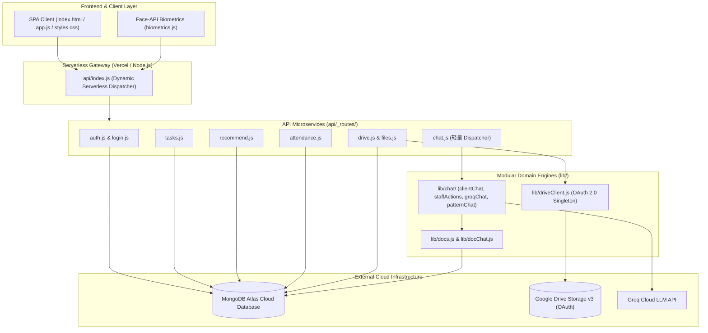
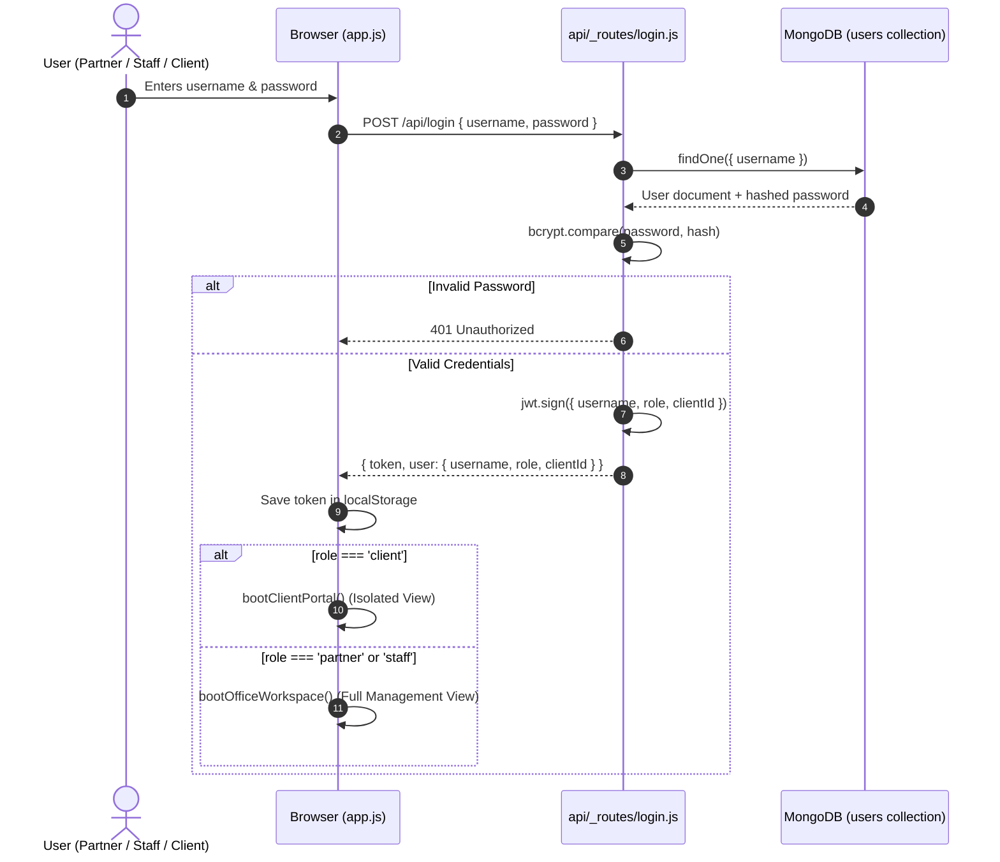
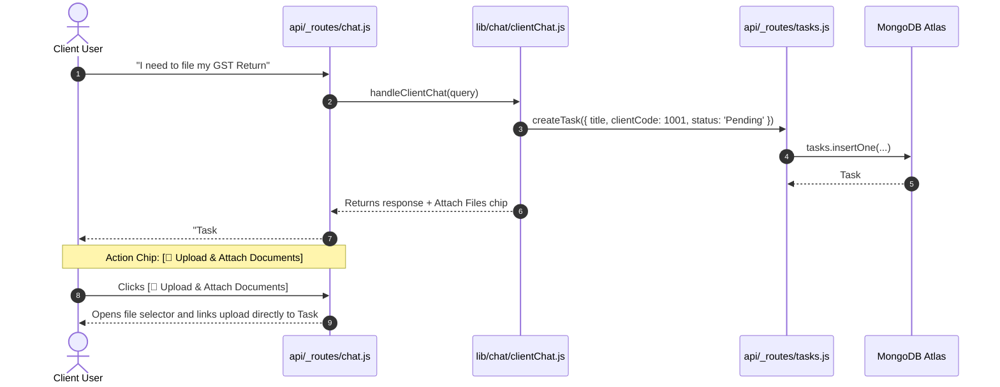
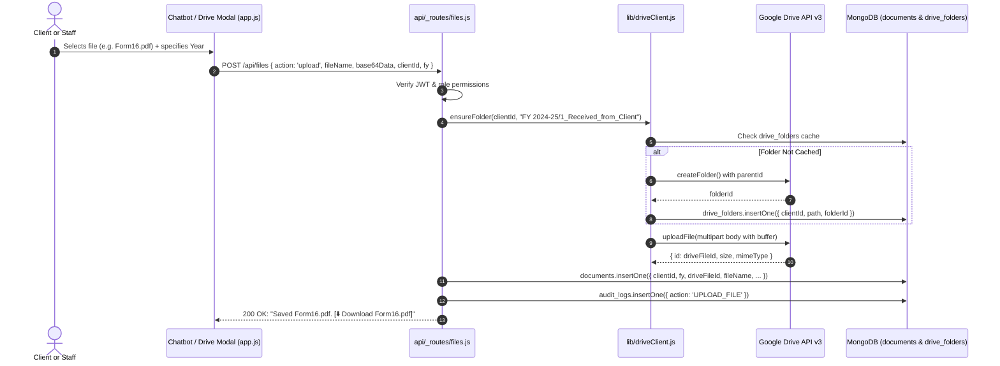
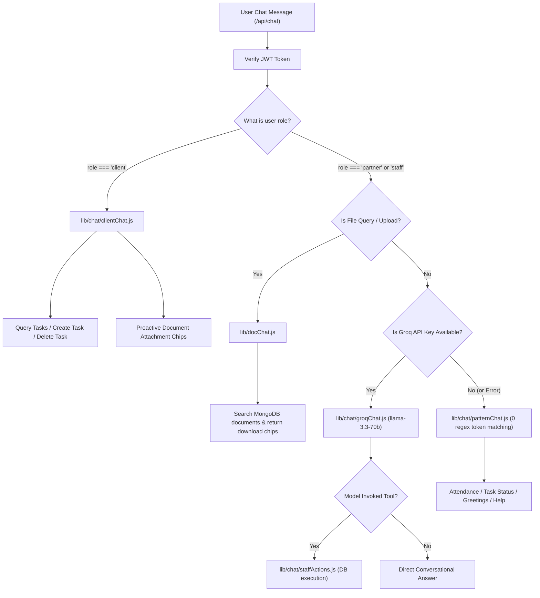

# CA Office Workflow Management System
## Architecture, File Dictionary, Data Flows & Demonstration Guide

---

## 1. Executive System Overview

The **CA Office Workflow Management System** is a full-stack, enterprise-grade practice management platform tailored for Chartered Accountant (CA) firms and financial consultancies. It is built to run seamlessly both as a local Node.js application and as a serverless deployment on **Vercel**, backed by **Cloud MongoDB Atlas** and **Google Drive OAuth 2.0 API v3**.

### Core Pillars
1. **Multi-Role Security & Isolation**: Strict Role-Based Access Control (RBAC) separating **Partners** (Administrators), **Managers/Staff/Articles**, and **Clients**. Clients have strict data sandboxing preventing cross-client visibility.
2. **Google Drive Cloud Vault via OAuth 2.0**: Eliminates service account quota restrictions by using personal/workspace Google Drive OAuth 2.0 tokens (`refresh_token`) to store, organize, and stream documents into structured folder hierarchies (`FY 2024-25/1_Received_from_Client`, `3_Filed_Returns`, `01_KYC`, etc.).
3. **Hybrid AI & Deterministic Chatbot**: Modularized microservice architecture featuring:
   - Client portal chatbot for task and file operations.
   - Staff tool-calling LLM via Groq API (`llama-3.3-70b-versatile`).
   - 100% regex-free token-based pattern engine as deterministic fallback.
4. **Biometric & Geofenced Attendance**: In-browser facial recognition using `face-api.js` (128-dimensional descriptor Euclidean distance matching) coupled with browser Geolocation verification.
5. **Smart Task & Staff Allocation**: Workload and skill-based recommendation engine for task assignments and SLA deadline tracking.



---

## 2. Comprehensive File Directory & Role Breakdown

### 2.1 Root & Frontend Files

| File | Purpose | Key Responsibilities |
|---|---|---|
| [`index.html`](file:///c:/Users/mukes/Downloads/Workflow-Management-sanjjey-2/Workflow-Management-sanjjey-2/index.html) | Single Page Application Markup | Contains semantic layout for Dashboard, Task Kanban/List, Client Directory, Biometric Punch Modal, Document Vault, and Floating Chatbot Widget with file attachment chips and action buttons. |
| [`styles.css`](file:///c:/Users/mukes/Downloads/Workflow-Management-sanjjey-2/Workflow-Management-sanjjey-2/styles.css) | Application Styling & Design System | Professional dark/light mode responsive design system, WCAG AA contrast, custom modals, action chips, status badges, and mobile-adaptive flex/grid layouts. |
| [`app.js`](file:///c:/Users/mukes/Downloads/Workflow-Management-sanjjey-2/Workflow-Management-sanjjey-2/app.js) | Frontend Application Controller | Manages user session state, JWT tokens in `localStorage`, API communications (`authFetch`), UI state transitions, Client Portal view gating (`bootClientPortal`), chat bubble rendering, and file upload lifecycle. |
| [`biometrics.js`](file:///c:/Users/mukes/Downloads/Workflow-Management-sanjjey-2/Workflow-Management-sanjjey-2/biometrics.js) | Client-side Face Recognition | Loads `face-api.js` neural net models (`tinyFaceDetector`, `faceLandmark68Net`, `faceRecognitionNet`), captures webcam streams, computes 128D face descriptors, and validates distance against enrolled descriptors. |
| [`server.js`](file:///c:/Users/mukes/Downloads/Workflow-Management-sanjjey-2/Workflow-Management-sanjjey-2/server.js) | Local Express Development Server | Emulates Vercel serverless environment locally by reading route params, setting static file headers, providing body parsing, and routing `/api/*` requests to `api/index.js`. |
| [`vercel.json`](file:///c:/Users/mukes/Downloads/Workflow-Management-sanjjey-2/Workflow-Management-sanjjey-2/vercel.json) | Vercel Deployment Configuration | Configures serverless route rewriting: maps all incoming requests to `/api/(.*)` into `/api/index.js?route=$1`. |
| [`package.json`](file:///c:/Users/mukes/Downloads/Workflow-Management-sanjjey-2/Workflow-Management-sanjjey-2/package.json) | Dependencies & NPM Scripts | Declares core dependencies (`mongodb`, `googleapis`, `jsonwebtoken`, `bcryptjs`) and automation commands (`start`, `dev`, `test`). |
| [`.env.example`](file:///c:/Users/mukes/Downloads/Workflow-Management-sanjjey-2/Workflow-Management-sanjjey-2/.env.example) | Environment Variable Template | Lists placeholder configuration for `MONGODB_URI`, `JWT_SECRET`, `GOOGLE_OAUTH_CLIENT_ID`, `GOOGLE_OAUTH_CLIENT_SECRET`, `GOOGLE_OAUTH_REFRESH_TOKEN`, `GOOGLE_DRIVE_FOLDER_ID`, and `GROQ_API_KEY`. |
| [`.gitignore`](file:///c:/Users/mukes/Downloads/Workflow-Management-sanjjey-2/Workflow-Management-sanjjey-2/.gitignore) | Git Exclusion Rules | Prevents committing secret files (`.env`, `oauth-credentials.json`, `google.json`, `node_modules`, `sample_data`). |

---

### 2.2 Serverless API Routes (`api/` and `api/_routes/`)

All requests arrive at [`api/index.js`](file:///c:/Users/mukes/Downloads/Workflow-Management-sanjjey-2/Workflow-Management-sanjjey-2/api/index.js), which dynamically requires and executes the matching route handler under `api/_routes/`.

```
/api/<route>  ──►  api/index.js  ──►  require('./_routes/' + route)
```

| Route File | HTTP Methods | Primary Operations & Business Logic |
|---|---|---|
| [`api/index.js`](file:///c:/Users/mukes/Downloads/Workflow-Management-sanjjey-2/Workflow-Management-sanjjey-2/api/index.js) | ALL | Serverless entry gateway. Dispatches requests to `api/_routes/${route}.js`, handles body parsing for serverless environments, and standardizes error responses. |
| [`api/_routes/login.js`](file:///c:/Users/mukes/Downloads/Workflow-Management-sanjjey-2/Workflow-Management-sanjjey-2/api/_routes/login.js) | `POST` | Authenticates Partners, Staff, and Clients using `bcryptjs` password hashing. Injects user identity, role, and optional `clientId` into signed JWT tokens (24h expiry). |
| [`api/_routes/auth.js`](file:///c:/Users/mukes/Downloads/Workflow-Management-sanjjey-2/Workflow-Management-sanjjey-2/api/_routes/auth.js) | `GET` | Validates active JWT sessions, provides token verification middleware helper (`verifyToken`), role-checking utility (`checkRole`), and audit logging (`logAuditAction`). |
| [`api/_routes/tasks.js`](file:///c:/Users/mukes/Downloads/Workflow-Management-sanjjey-2/Workflow-Management-sanjjey-2/api/_routes/tasks.js) | `GET`, `POST`, `PUT`, `DELETE` | Task lifecycle engine. Enforces client task isolation (clients only see and delete their own tasks), handles file attachments array, task status progression, priority, assignment, and delete guards (cannot delete Filed/Closed tasks). |
| [`api/_routes/clients.js`](file:///c:/Users/mukes/Downloads/Workflow-Management-sanjjey-2/Workflow-Management-sanjjey-2/api/_routes/clients.js) | `GET`, `POST`, `PUT`, `DELETE` | Client master management. Handles client CRUD, GSTIN/PAN info, contact details, and the `seed_clients` batch synchronization endpoint. |
| [`api/_routes/files.js`](file:///c:/Users/mukes/Downloads/Workflow-Management-sanjjey-2/Workflow-Management-sanjjey-2/api/_routes/files.js) | `GET`, `POST` | Dedicated Drive file bridge. Handles direct streaming downloads (`action=download`) with ownership checks, and multi-folder Drive uploads (`action=upload`) with base64 payloads and MongoDB metadata tracking. |
| [`api/_routes/drive.js`](file:///c:/Users/mukes/Downloads/Workflow-Management-sanjjey-2/Workflow-Management-sanjjey-2/api/_routes/drive.js) | `GET` | Partner-only Google Drive OAuth health check endpoint. Tests connection against Drive API v3 without leaking secrets. |
| [`api/_routes/chat.js`](file:///c:/Users/mukes/Downloads/Workflow-Management-sanjjey-2/Workflow-Management-sanjjey-2/api/_routes/chat.js) | `POST` | Master chatbot dispatcher (115 lines). Gated by user role: delegates client requests to `clientChat.js` and staff requests to `groqChat.js` / `patternChat.js`. |
| [`api/_routes/attendance.js`](file:///c:/Users/mukes/Downloads/Workflow-Management-sanjjey-2/Workflow-Management-sanjjey-2/api/_routes/attendance.js) | `GET`, `POST`, `PUT` | Clock-in and clock-out processing. Records biometric verification status, timestamp (IST), coordinates, leave requests, on-duty (OD) status, and attendance summaries. |
| [`api/_routes/users.js`](file:///c:/Users/mukes/Downloads/Workflow-Management-sanjjey-2/Workflow-Management-sanjjey-2/api/_routes/users.js) | `GET`, `POST`, `PUT`, `DELETE` | User account administration. Partner-only user creation (with support for `role: 'client'` linked to `clientId`), password updates, and biometric face descriptor storage. |
| [`api/_routes/recommend.js`](file:///c:/Users/mukes/Downloads/Workflow-Management-sanjjey-2/Workflow-Management-sanjjey-2/api/_routes/recommend.js) | `POST` | Intelligent staff assignment engine. Evaluates staff active task workloads, category specializations (GST, ITR, Audit), and suggests the most optimal operator. |
| [`api/_routes/automate.js`](file:///c:/Users/mukes/Downloads/Workflow-Management-sanjjey-2/Workflow-Management-sanjjey-2/api/_routes/automate.js) | `POST` | Automated background compliance checker. Scans upcoming statutory deadlines, overdue tasks, and sends reminders. |
| [`api/_routes/audit.js`](file:///c:/Users/mukes/Downloads/Workflow-Management-sanjjey-2/Workflow-Management-sanjjey-2/api/_routes/audit.js) | `GET` | Partner-only security and compliance audit trail viewer. |
| [`api/_routes/db.js`](file:///c:/Users/mukes/Downloads/Workflow-Management-sanjjey-2/Workflow-Management-sanjjey-2/api/_routes/db.js) | `GET` | Low-level MongoDB Atlas connection pool management and database singleton provider. |
| [`api/_routes/init.js`](file:///c:/Users/mukes/Downloads/Workflow-Management-sanjjey-2/Workflow-Management-sanjjey-2/api/_routes/init.js) | `GET`, `POST` | System bootstrapper. Creates database collections, unique compound indexes, and the default Partner account if missing. |
| [`api/_routes/engagements.js`](file:///c:/Users/mukes/Downloads/Workflow-Management-sanjjey-2/Workflow-Management-sanjjey-2/api/_routes/engagements.js) | `GET`, `POST`, `PUT` | Recurring client service contracts (e.g. Monthly GST Filing, Quarterly TDS, Annual Audit). |

---

### 2.3 Domain Libraries & Chat Microservices (`lib/`)

To guarantee high maintainability and prevent monolithic bloat, business logic is split into focused modules under `lib/`:

```
lib/
├── driveClient.js          # Google Drive OAuth 2.0 API v3 singleton
├── docs.js                 # Document taxonomies, FY/AY algorithms (Regex-free)
├── docChat.js              # Drive search & classification conversation manager
└── chat/
    ├── chatHelpers.js      # IST dates, task ID generation, fuzzy client matcher
    ├── clientChat.js       # Client portal conversational microservice (Regex-free)
    ├── staffActions.js     # Explicit staff actions (create_task, advance_status, etc.)
    ├── groqChat.js         # Groq LLM tool-calling execution engine
    └── patternChat.js      # Deterministic fallback pattern engine (Regex-free)
```

#### Detailed Breakdown:
- [`lib/driveClient.js`](file:///c:/Users/mukes/Downloads/Workflow-Management-sanjjey-2/Workflow-Management-sanjjey-2/lib/driveClient.js)
  - **Purpose**: Server-side Google Drive OAuth 2.0 integration.
  - **Key Functions**:
    - `getOAuth2Client()`: Instantiates `google.auth.OAuth2` with Client ID, Secret, and Refresh Token.
    - `getDrive()`: Returns authenticated `google.drive({ version: 'v3', auth })` client.
    - `ensureFolder(db, clientId, clientName, relPath)`: Checks MongoDB collection `drive_folders` for existing folder IDs, creating missing hierarchical directories on Drive recursively and caching them in MongoDB.
    - `uploadFile(options)`: Streams multipart file buffer to Google Drive with parent folder placement.
    - `downloadFile(fileId)`: Streams media buffer from Google Drive API v3.
- [`lib/docs.js`](file:///c:/Users/mukes/Downloads/Workflow-Management-sanjjey-2/Workflow-Management-sanjjey-2/lib/docs.js)
  - **Purpose**: Document classification, Financial Year (FY) / Assessment Year (AY) conversion, and access validation.
  - **Key Functions**:
    - `isValidFy(fy)`: Validates FY format (`2024-25`) using string splitting and numeric sequence validation (0 regex).
    - `fyToAy(fy)`: Computes Assessment Year from Financial Year.
    - `matchDocTypes(text)`: Identifies document categories (Form 16, ITR-V, Bank Statement, KYC, Computation).
    - `canAccessDoc(decoded, doc)`: Enforces RBAC download permissions.
- [`lib/docChat.js`](file:///c:/Users/mukes/Downloads/Workflow-Management-sanjjey-2/Workflow-Management-sanjjey-2/lib/docChat.js)
  - **Purpose**: Conversational document discovery and upload classification flow.
  - **Key Functions**:
    - `handleDocChat()`: Intercepts document requests like *"send my Form 16"* and upload proposals (`action: 'classify_upload'`), returning download chips or folder proposals.
- [`lib/chat/chatHelpers.js`](file:///c:/Users/mukes/Downloads/Workflow-Management-sanjjey-2/Workflow-Management-sanjjey-2/lib/chat/chatHelpers.js)
  - **Purpose**: Shared utilities for chat microservices.
  - **Key Functions**:
    - `getTodayIST()`, `getCurrentTimeIST()`: Calculates timezone-accurate Indian Standard Time.
    - `generateNextTaskId(db)`: Atomically computes numeric ID for new tasks.
    - `fuzzyFindClient(db, query)`: Identifies client by ID or substring name match without regex.
    - `resolveTaskFromQuery(db, query)`: Resolves task by `#<id>` or task title.
- [`lib/chat/clientChat.js`](file:///c:/Users/mukes/Downloads/Workflow-Management-sanjjey-2/Workflow-Management-sanjjey-2/lib/chat/clientChat.js)
  - **Purpose**: Dedicated chatbot logic for logged-in clients.
  - **Key Capabilities**:
    - Queries active tasks assigned to the client.
    - Creates client tasks and proactively returns action chips asking if the client wants to attach supporting documents.
    - Handles safe task cancellation/deletion with interactive confirmation.
    - Formats quick-action chips (`📁 Upload Documents`, `➕ Add New Task`, `📋 My Tasks`).
- [`lib/chat/staffActions.js`](file:///c:/Users/mukes/Downloads/Workflow-Management-sanjjey-2/Workflow-Management-sanjjey-2/lib/chat/staffActions.js)
  - **Purpose**: Section A explicit backend action handler.
  - **Key Actions**: `create_task`, `advance_status`, `update_task`, `delete_task`, `assign_task`, `create_client`, `mark_od`, `view_attendance`.
- [`lib/chat/groqChat.js`](file:///c:/Users/mukes/Downloads/Workflow-Management-sanjjey-2/Workflow-Management-sanjjey-2/lib/chat/groqChat.js)
  - **Purpose**: Groq LLM tool-calling conversational agent (`llama-3.3-70b-versatile`).
  - **Key Functions**:
    - `handleGroqChat(db, decoded, query, userContext)`: Constructs dynamic system prompts containing active staff, pending tasks, and client lists, registers function call schemas, and executes tool calls directly against MongoDB.
- [`lib/chat/patternChat.js`](file:///c:/Users/mukes/Downloads/Workflow-Management-sanjjey-2/Workflow-Management-sanjjey-2/lib/chat/patternChat.js)
  - **Purpose**: Zero-regex deterministic fallback pattern engine.
  - **Key Functions**:
    - Uses token sets, keyword arrays, and substring checks to answer attendance queries, list tasks, show help, or route actions when Groq API is offline or unconfigured.

---

### 2.4 Automation Scripts (`scripts/`)

| Script | Purpose | Usage Command |
|---|---|---|
| [`scripts/get_refresh_token.js`](file:///c:/Users/mukes/Downloads/Workflow-Management-sanjjey-2/Workflow-Management-sanjjey-2/scripts/get_refresh_token.js) | Interactive OAuth CLI helper | Launches a local webserver (`http://localhost:3000/oauth2callback`), opens the Google consent screen, and exchanges authorization codes for a permanent `GOOGLE_OAUTH_REFRESH_TOKEN`. |
| [`scripts/seed_client_users.js`](file:///c:/Users/mukes/Downloads/Workflow-Management-sanjjey-2/Workflow-Management-sanjjey-2/scripts/seed_client_users.js) | Bulk Client Portal User Seeding | Reads existing clients from MongoDB and creates client user login accounts with default passwords (`1234`) and linked `clientId`. |
| [`scripts/seed_sample_drive_docs.js`](file:///c:/Users/mukes/Downloads/Workflow-Management-sanjjey-2/Workflow-Management-sanjjey-2/scripts/seed_sample_drive_docs.js) | Demo Data Seeding Script | Creates sample client directories on Google Drive, uploads dummy PDF documents (Form 16, ITR-V, PAN), and indexes them in MongoDB `documents`. |
| [`scripts/sync_drive_to_mongo.js`](file:///c:/Users/mukes/Downloads/Workflow-Management-sanjjey-2/Workflow-Management-sanjjey-2/scripts/sync_drive_to_mongo.js) | Drive-to-MongoDB Sync Engine | Traverses Google Drive folders, identifies existing PDF/Excel files, and synchronizes document metadata records into MongoDB Atlas. |
| [`scripts/test_drive_connection.js`](file:///c:/Users/mukes/Downloads/Workflow-Management-sanjjey-2/Workflow-Management-sanjjey-2/scripts/test_drive_connection.js) | OAuth Verification Utility | Uploads a temporary test file to Google Drive, reads back contents, verifies integrity, deletes the file, and confirms OAuth connectivity. |

---

### 2.5 Automated Test Suites (`tests/`)

The application includes 25 automated tests executed via `npm test`:

1. [`tests/client_workflow.test.js`](file:///c:/Users/mukes/Downloads/Workflow-Management-sanjjey-2/Workflow-Management-sanjjey-2/tests/client_workflow.test.js) (16 tests)
   - Verifies client user creation, role permission guards, client task isolation, client search boundaries, client task deletion controls, and staff recommendation API.
2. [`tests/task_attachments.test.js`](file:///c:/Users/mukes/Downloads/Workflow-Management-sanjjey-2/Workflow-Management-sanjjey-2/tests/task_attachments.test.js) (4 tests)
   - Verifies task creation with attached files array, chatbot file prompt chips, upload classification, and task linkage.
3. [`tests/staff_chat_actions.test.js`](file:///c:/Users/mukes/Downloads/Workflow-Management-sanjjey-2/Workflow-Management-sanjjey-2/tests/staff_chat_actions.test.js) (5 tests)
   - Verifies explicit staff actions (`create_task`, `advance_status`) and the regex-free pattern engine (greetings, clock-in guidance, task summaries).
4. [`tests/drive_e2e.test.js`](file:///c:/Users/mukes/Downloads/Workflow-Management-sanjjey-2/Workflow-Management-sanjjey-2/tests/drive_e2e.test.js)
   - Comprehensive end-to-end integration test of Google Drive OAuth folder hierarchy creation, document queries, file downloads, and audit logs.

---

## 3. End-to-End Data Flows

### 3.1 Authentication & Role-Based Access Control (RBAC)



---

### 3.2 Task Creation & Supporting Document Attachment Flow

Clients and staff can create tasks with attached documents. When created via Chatbot, the chatbot automatically prompts the user with action chips to attach supporting files.



---

### 3.3 Google Drive OAuth 2.0 Document Pipeline



---

### 3.4 AI Chatbot Dual-Engine Execution Pipeline



---

## 4. Key Function Dictionary & Code Locations

| Function | File | Signature | Description |
|---|---|---|---|
| `verifyToken` | [`api/_routes/auth.js`](file:///c:/Users/mukes/Downloads/Workflow-Management-sanjjey-2/Workflow-Management-sanjjey-2/api/_routes/auth.js) | `(req) => decodedToken \| null` | Extracts and verifies JWT from `Authorization: Bearer <token>` header. |
| `checkRole` | [`api/_routes/auth.js`](file:///c:/Users/mukes/Downloads/Workflow-Management-sanjjey-2/Workflow-Management-sanjjey-2/api/_routes/auth.js) | `(decoded, allowedRoles) => boolean` | Enforces RBAC permissions. |
| `logAuditAction` | [`api/_routes/auth.js`](file:///c:/Users/mukes/Downloads/Workflow-Management-sanjjey-2/Workflow-Management-sanjjey-2/api/_routes/auth.js) | `(db, username, action, details) => Promise` | Writes immutable audit log entries into MongoDB. |
| `getOAuth2Client` | [`lib/driveClient.js`](file:///c:/Users/mukes/Downloads/Workflow-Management-sanjjey-2/Workflow-Management-sanjjey-2/lib/driveClient.js) | `() => OAuth2Client` | Instantiates Google OAuth client with refresh token credentials. |
| `ensureFolder` | [`lib/driveClient.js`](file:///c:/Users/mukes/Downloads/Workflow-Management-sanjjey-2/Workflow-Management-sanjjey-2/lib/driveClient.js) | `(db, clientId, name, relPath) => Promise<string>` | Recursively creates and caches Google Drive folder IDs. |
| `uploadFile` | [`lib/driveClient.js`](file:///c:/Users/mukes/Downloads/Workflow-Management-sanjjey-2/Workflow-Management-sanjjey-2/lib/driveClient.js) | `(options) => Promise<DriveFile>` | Streams file buffer into Google Drive API v3. |
| `downloadFile` | [`lib/driveClient.js`](file:///c:/Users/mukes/Downloads/Workflow-Management-sanjjey-2/Workflow-Management-sanjjey-2/lib/driveClient.js) | `(fileId) => Promise<ReadableStream>` | Fetches media stream of a file from Google Drive. |
| `isValidFy` | [`lib/docs.js`](file:///c:/Users/mukes/Downloads/Workflow-Management-sanjjey-2/Workflow-Management-sanjjey-2/lib/docs.js) | `(fy) => boolean` | Validates Financial Year format (e.g. `2024-25`) without regex. |
| `matchDocTypes` | [`lib/docs.js`](file:///c:/Users/mukes/Downloads/Workflow-Management-sanjjey-2/Workflow-Management-sanjjey-2/lib/docs.js) | `(text) => string[] \| null` | Matches document taxonomy keywords from user prompts. |
| `handleClientChat` | [`lib/chat/clientChat.js`](file:///c:/Users/mukes/Downloads/Workflow-Management-sanjjey-2/Workflow-Management-sanjjey-2/lib/chat/clientChat.js) | `(db, decoded, query, action, body) => Promise<ChatResponse>` | Dedicated client-side conversational handler with task and upload chips. |
| `handleStaffAction` | [`lib/chat/staffActions.js`](file:///c:/Users/mukes/Downloads/Workflow-Management-sanjjey-2/Workflow-Management-sanjjey-2/lib/chat/staffActions.js) | `(db, decoded, actionName, args) => Promise<Result>` | Executes explicit staff actions (e.g., `create_task`, `advance_status`). |
| `handleGroqChat` | [`lib/chat/groqChat.js`](file:///c:/Users/mukes/Downloads/Workflow-Management-sanjjey-2/Workflow-Management-sanjjey-2/lib/chat/groqChat.js) | `(db, decoded, query, context) => Promise<ChatResponse>` | Dispatches natural language queries to Groq LLM tool-calling engine. |
| `handlePatternChat` | [`lib/chat/patternChat.js`](file:///c:/Users/mukes/Downloads/Workflow-Management-sanjjey-2/Workflow-Management-sanjjey-2/lib/chat/patternChat.js) | `(db, decoded, query, action, body) => Promise<ChatResponse>` | Zero-regex deterministic fallback engine. |

---

## 5. MongoDB Atlas Database Schemas

### 1. `users` Collection
```json
{
  "_id": "ObjectId('...')",
  "username": "client_1001",
  "password": "$2a$10$hashed_password...",
  "name": "Acme Industries",
  "role": "client",
  "clientId": 1001,
  "requireBiometric": false,
  "faceDescriptor": null,
  "createdAt": "ISODate('...')"
}
```

### 2. `tasks` Collection
```json
{
  "_id": "ObjectId('...')",
  "id": 10042,
  "title": "GST Monthly Return Filing - September",
  "clientCode": 1001,
  "clientName": "Acme Industries",
  "category": "GST",
  "allocatedTo": "siva",
  "priority": "High",
  "status": "Pending",
  "dueDate": "2026-10-20",
  "attachedFiles": [
    {
      "name": "GSTR3B_Summary.pdf",
      "docId": "67a3f8...",
      "uploadedAt": "ISODate('...')"
    }
  ],
  "history": [
    { "status": "Pending", "updatedBy": "client_1001", "updatedAt": "ISODate('...')" }
  ]
}
```

### 3. `documents` Collection
```json
{
  "_id": "ObjectId('...')",
  "clientId": 1001,
  "clientName": "Acme Industries",
  "fy": "2024-25",
  "ay": "2025-26",
  "category": "received",
  "docType": "Form 16",
  "fileName": "Form16_2024-25.pdf",
  "driveFileId": "1aB2cD3e...",
  "driveFolderId": "1uQnyR7B...",
  "folderPath": "FY 2024-25 (AY 2025-26)/1_Received_from_Client",
  "mimeType": "application/pdf",
  "size": 245100,
  "clientVisible": true,
  "uploadedBy": "client_1001",
  "uploadedAt": "ISODate('...')"
}
```

---

## 6. Demonstration Script (Step-by-Step Walkthrough)

Use this structured walkthrough during your live demonstration to present all major system capabilities:

### Step 1: Partner (Admin) Dashboard & Multi-Role Architecture
1. **Login**: Sign in as Partner (`admin` / password: as configured).
2. **Show Global Workspace**: Point out the live overview cards (Total Tasks, Pending Review, Overdue SLA, Active Staff).
3. **Show RBAC**: Navigate to Users, highlight the difference between Partners, Staff/Articles, and Clients.

### Step 2: Client Portal & Data Isolation
1. **Login as Client**: Sign in as Client `1001` (Password: `1234`).
2. **Point out Sandboxing**: The interface automatically switches to the simplified **Client Portal**.
3. **Show Isolation**: Notice that Client 1001 *only* sees tasks and documents belonging to Client 1001. Other clients' data is completely hidden.

### Step 3: Interactive Chatbot Task Creation with File Attachment
1. **Open Floating Chatbot**: In the Client Portal, type:
   > *"Add a task for Annual Tax Return"*
2. **Observe Instant Creation**: The chatbot automatically creates the task linked to Client `1001`.
3. **Observe Attachment Prompt**: The chatbot proactively responds:
   > *"Task #10043 created! Would you like to attach supporting documents to this task?"*
   And renders action chips: `[📁 Attach Documents Now]`, `[📋 View My Tasks]`.
4. **Attach File**: Click the chip to select and upload a PDF directly to Google Drive.

### Step 4: Google Drive OAuth File Search & One-Click Download
1. In the chat, type:
   > *"Send my Form 16"*
2. **Show Instant Search**: The system queries MongoDB and returns immediate download chips:
   > `[⬇️ Form16_2023-24.pdf]`
3. **Download**: Click the chip; the server streams the file directly from Google Drive using OAuth 2.0.

### Step 5: Staff Management & Deterministic / AI Chat Actions
1. **Switch back to Staff/Partner**.
2. **Test Natural Language Staff Actions**:
   - Query: *"Who is present today?"* → Returns real-time biometric attendance.
   - Action: *"Advance task 10001 to Pending Review"* → Automatically updates task stage.
   - Allocation: Type *"Assign GST return to Siva"* or use `/api/recommend` to show the AI workload balancer.

### Step 6: Automated Test Verification
1. Open terminal and run:
   ```bash
   npm test
   ```
2. Show the evaluator that all **25 unit, integration, and E2E Drive tests pass with 100% success**.
